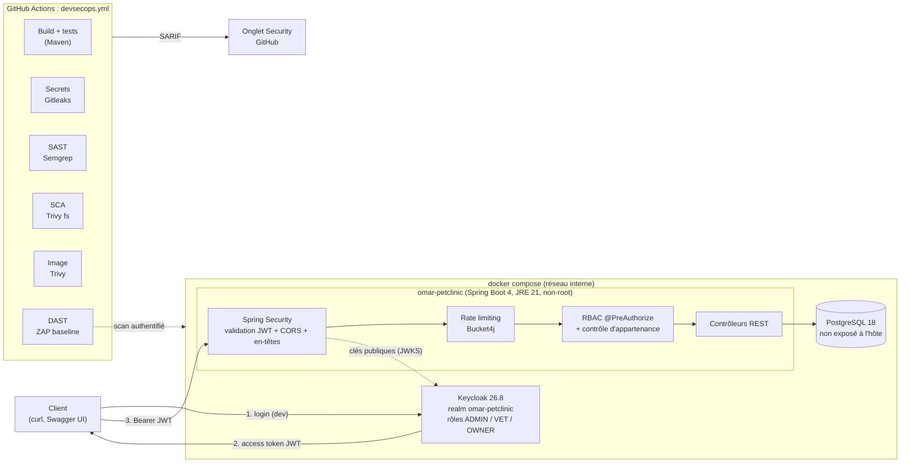

# omar-petclinic

[](https://github.com/omarsaidiA/omar-petclinic/actions/workflows/devsecops.yml)
[](LICENSE.txt)


Version **sécurisée** de l'API REST [Spring Petclinic](https://github.com/spring-petclinic/spring-petclinic-rest) :
authentification OAuth2 avec Keycloak, contrôle d'accès par rôles (RBAC) jusqu'au niveau de
chaque objet, durcissement applicatif et pipeline DevSecOps complet.

C'est un projet portfolio AppSec/DevSecOps. Je suis parti d'une application open source réelle,
j'ai mesuré ses failles avec des outils et une revue de code, puis je les ai corrigées et
documentées.

## Objectifs sécurité

| Objectif | Mise en œuvre |
|---|---|
| Aucun accès anonyme à l'API | Resource server OAuth2 : JWT Keycloak validé (signature JWKS, émetteur, audience), sessions stateless |
| Moindre privilège | Rôles ADMIN, VET et OWNER ; un OWNER ne lit que ses propres données (claim `owner_id`), contre les IDOR et BOLA |
| Défense en profondeur | Règles au niveau URL **et** méthode (`@PreAuthorize`), validation des entrées, rate limiting, en-têtes de sécurité |
| Pas de fuite d'information | Erreurs au format RFC 9457 sans stack trace ni nom de classe ; seul `/actuator/health` est public |
| Traçabilité | Journal `SECURITY` (échecs d'authentification, refus d'accès, 429) sans token ni données personnelles, protégé contre l'injection de logs |
| Aucun secret dans le code | Variables d'environnement uniquement ; Gitleaks analyse tout l'historique git |
| Sécurité continue | Pipeline SAST, SCA, scan d'image, DAST et détection de secrets ; échec sur HIGH/CRITICAL ; résultats SARIF dans l'onglet *Security* |
| Chaîne d'approvisionnement | Actions GitHub épinglées par SHA, images d'outils à version fixe, Dependabot avec *cooldown* |

## Architecture



## Ce que j'ai ajouté

Par rapport au projet d'origine (le détail commit par commit est dans l'historique git) :

**Infrastructure**
- `Dockerfile` multi-stage : build Maven sur JDK, exécution sur JRE Alpine minimal, utilisateur non-root (UID 10001), jar en lecture seule, healthcheck.
- `docker-compose.yml` : API, PostgreSQL et Keycloak avec import automatique du realm. Système de fichiers en lecture seule, aucune capability Linux, `no-new-privileges`, base de données non exposée.
- Realm Keycloak versionné (`keycloak/`) : rôles, client avec mappers d'audience et `owner_id`, protection contre la force brute, politique de mots de passe stricte.

**Authentification et autorisation**
- Remplacement de Basic Auth par un resource server OAuth2 (JWT Keycloak).
- `KeycloakRealmRoleConverter` : convertit les rôles Keycloak en authorities Spring, en ne gardant que les rôles connus.
- Matrice RBAC sur les 36 endpoints et `OwnershipEvaluator` : un OWNER n'accède qu'à ses propres ressources.
- CORS strict et configurable ; CSP, HSTS, `X-Content-Type-Options`, `X-Frame-Options`, `Referrer-Policy`.
- Gestion d'erreurs globale sans fuite d'information.

**Durcissement**
- Bean Validation renforcée dans le contrat OpenAPI : longueurs, tailles de listes, mot de passe de 12 à 72 caractères.
- Rate limiting Bucket4j par utilisateur ou par IP, dans un cache borné ; réponse 429 avec `Retry-After`.
- Journal d'audit de sécurité.
- Mots de passe hachés en BCrypt ; console H2 désactivée ; CVE de dépendance corrigée.

**DevSecOps**
- Pipeline `.github/workflows/devsecops.yml` en 6 jobs (voir ci-dessous) et configuration Dependabot.
- Plan ZAP (`.zap/baseline.yaml`) : scan authentifié avec import du contrat OpenAPI.
- [`SECURITY-FINDINGS.md`](SECURITY-FINDINGS.md) : 18 vulnérabilités trouvées et corrigées, avec l'état avant/après, dont 2 failles BOLA et des mots de passe stockés en clair.

**Tests**
- Plus de 40 tests de sécurité avec `spring-security-test` (`jwt()`) : pour chaque rôle, accès autorisé **et** refusé, ainsi que BOLA, CORS, en-têtes, validation, rate limiting et logs d'audit. Au total, 293 tests.

## Démarrage

Prérequis : Docker (avec Compose v2). Pour lancer les tests hors conteneur : JDK 21.

```bash
cp .env.example .env
# Renseigner POSTGRES_PASSWORD et KEYCLOAK_ADMIN_PASSWORD, par exemple avec : openssl rand -base64 24
docker compose up -d --build --wait
```

| Service | URL |
|---|---|
| API | http://localhost:9966/petclinic/api |
| Swagger UI | http://localhost:9966/petclinic/swagger-ui/index.html |
| Santé | http://localhost:9966/petclinic/actuator/health |
| Console Keycloak | http://localhost:8080 (identifiants définis dans `.env`) |

Obtenir un token, puis appeler l'API :

```bash
TOKEN=$(curl -s -X POST http://localhost:8080/realms/omar-petclinic/protocol/openid-connect/token \
  -d grant_type=password -d client_id=omar-petclinic-api \
  -d username=vet --data-urlencode 'password=Vet-DevOnly-2026!' | jq -r .access_token)

curl -H "Authorization: Bearer $TOKEN" http://localhost:9966/petclinic/api/owners     # 200
curl -X DELETE -H "Authorization: Bearer $TOKEN" http://localhost:9966/petclinic/api/pets/1  # 403 : un VET ne supprime pas
curl http://localhost:9966/petclinic/api/owners                                       # 401 : aucun token
```

### Utilisateurs de test

> **Réservés au développement.** Ils sont définis uniquement dans `keycloak/omar-petclinic-realm.json`.

| Utilisateur | Mot de passe | Rôle | Droits |
|---|---|---|---|
| `admin` | `Admin-DevOnly-2026!` | ADMIN | Tout |
| `vet` | `Vet-DevOnly-2026!` | VET | Lecture des propriétaires et animaux, gestion des visites |
| `owner` | `Owner-DevOnly-2026!` | OWNER | Lecture seule de ses propres données (propriétaire n°1) |

### Matrice RBAC

| Ressource | ADMIN | VET | OWNER |
|---|---|---|---|
| Propriétaires : lecture | ✅ | ✅ | Le sien uniquement |
| Propriétaires : écriture | ✅ | ❌ | ❌ |
| Animaux : lecture | ✅ | ✅ | Les siens uniquement |
| Animaux : écriture | ✅ | ❌ | ❌ |
| Visites : lecture | ✅ | ✅ | Les siennes uniquement |
| Visites : création et modification | ✅ | ✅ | ❌ |
| Vétérinaires, spécialités | ✅ | Lecture | ❌ |
| Types d'animaux | ✅ | Lecture | Lecture |
| Utilisateurs (`/api/users`) | ✅ | ❌ | ❌ |

### Variables d'environnement

| Variable | Rôle | Défaut |
|---|---|---|
| `POSTGRES_PASSWORD` | Mot de passe PostgreSQL | **obligatoire** |
| `KEYCLOAK_ADMIN_PASSWORD` | Administrateur Keycloak | **obligatoire** |
| `CORS_ALLOWED_ORIGINS` | Origines navigateur autorisées (séparées par des virgules) | vide : aucune |
| `RATE_LIMIT_AUTHENTICATED_PER_MINUTE` | Limite par utilisateur | 120 |
| `RATE_LIMIT_ANONYMOUS_PER_MINUTE` | Limite par IP | 30 |
| `SWAGGER_UI_ENABLED` | Swagger UI (à désactiver en production) | `true` |

## Pipeline DevSecOps

Le workflow [`devsecops.yml`](.github/workflows/devsecops.yml) s'exécute à chaque push et à chaque pull request :

| Job | Outil | Échec si |
|---|---|---|
| Build et tests | Maven, JUnit, spring-security-test | Un test échoue |
| Détection de secrets | Gitleaks (historique git complet) | Un secret est trouvé |
| SAST | Semgrep (`p/java`, `p/owasp-top-ten`) | Un constat de sévérité ERROR |
| SCA | Trivy en mode filesystem (`pom.xml`, Dockerfile) | Une vulnérabilité HIGH ou CRITICAL |
| Scan d'image | Trivy (image Docker construite) | Une vulnérabilité HIGH ou CRITICAL corrigeable |
| DAST | ZAP baseline authentifié, contre la stack lancée dans le CI | Une alerte High |

Chaque outil envoie un rapport SARIF dans l'onglet **Security, Code scanning** du dépôt. Dependabot
surveille Maven, Docker, docker-compose et GitHub Actions, avec un *cooldown* de 7 jours et sans
fusion automatique.

## Développement

```bash
./mvnw verify   # build, 293 tests et couverture JaCoCo (JDK 21)
```

Sans Docker, l'application démarre sur une base H2 en mémoire (`java -jar target/omar-petclinic-*.jar`).
Il faut quand même un Keycloak accessible sur `localhost:8080` pour obtenir des tokens.

## Crédits

Ce projet est basé sur [**spring-petclinic/spring-petclinic-rest**](https://github.com/spring-petclinic/spring-petclinic-rest),
distribué sous licence [Apache 2.0](LICENSE.txt). Merci à ses auteurs et contributeurs. Le premier
commit importe le projet d'origine tel quel (référence du commit source dans son message) ; la
licence et toutes les mentions de copyright sont conservées. Les modifications apportées sont
listées dans la section [Ce que j'ai ajouté](#ce-que-jai-ajouté) et visibles commit par commit.

## Licence

[Apache License 2.0](LICENSE.txt)
